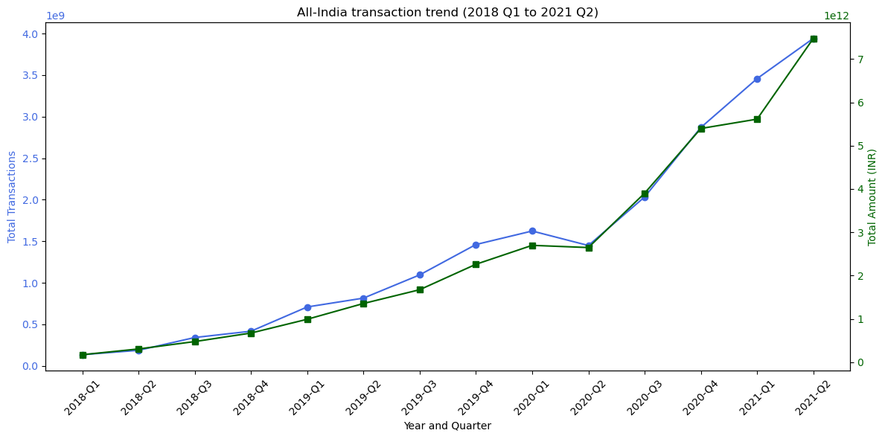
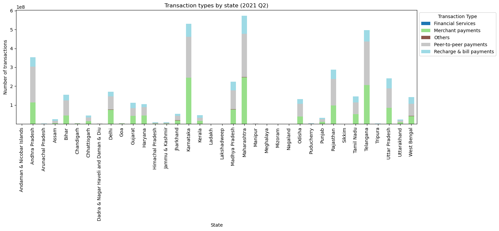
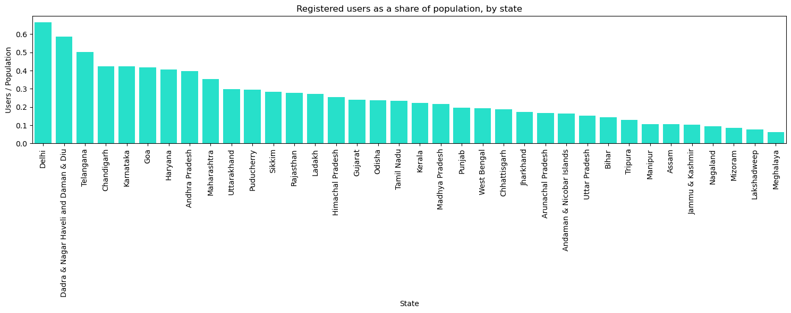
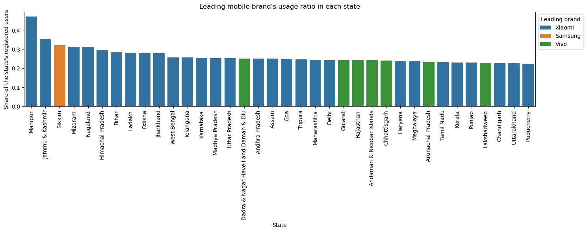
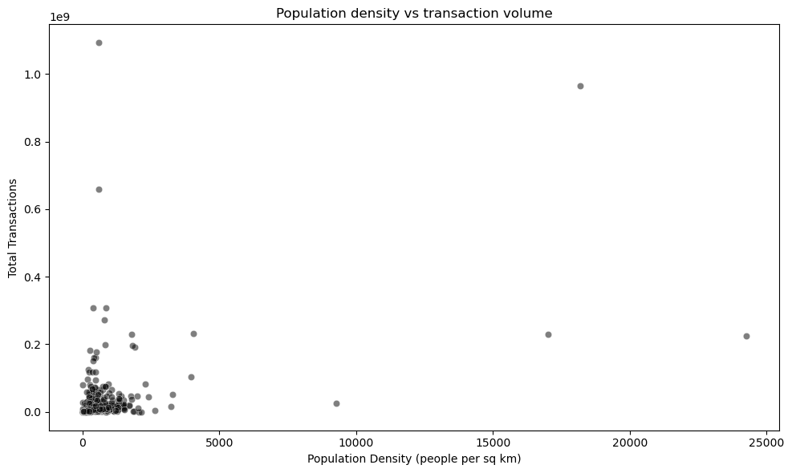
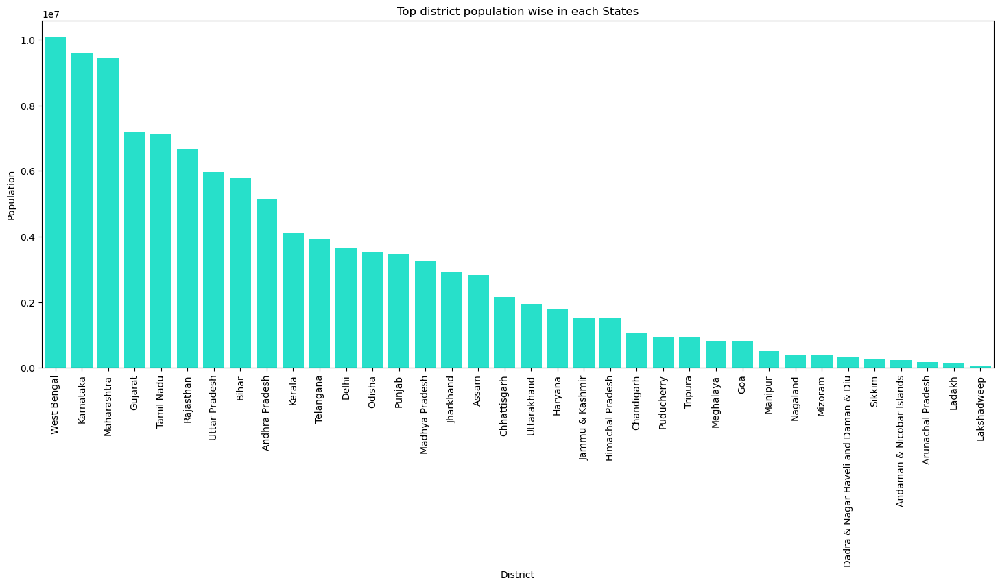
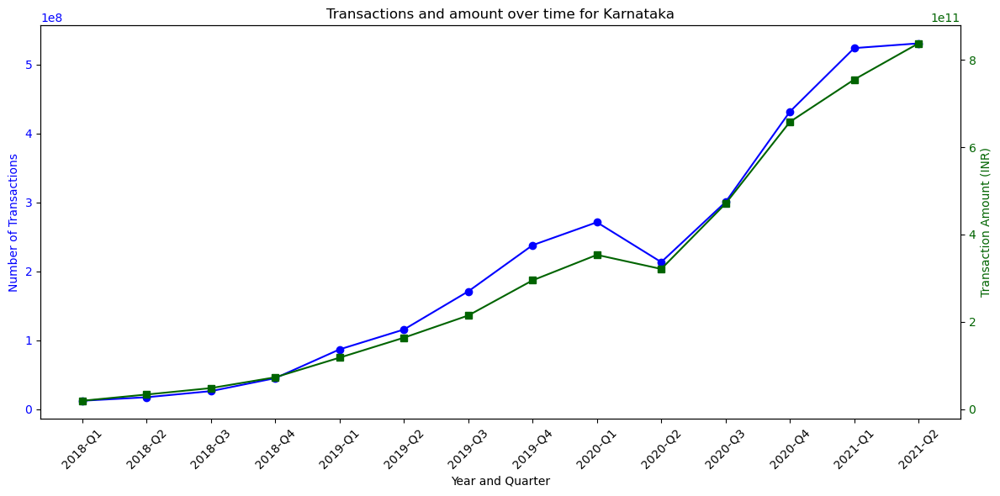
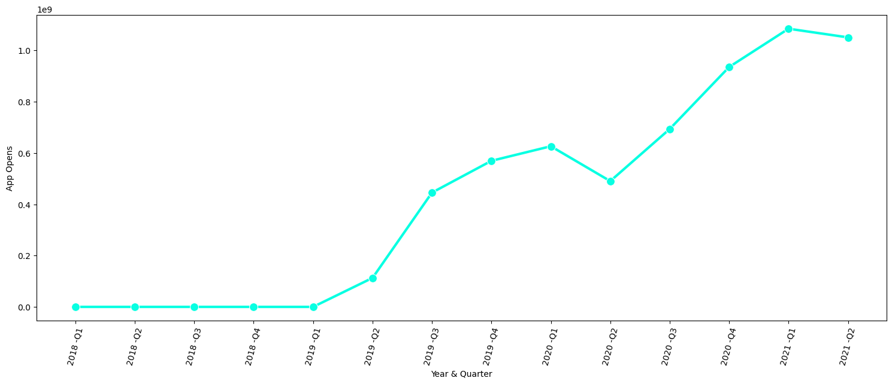
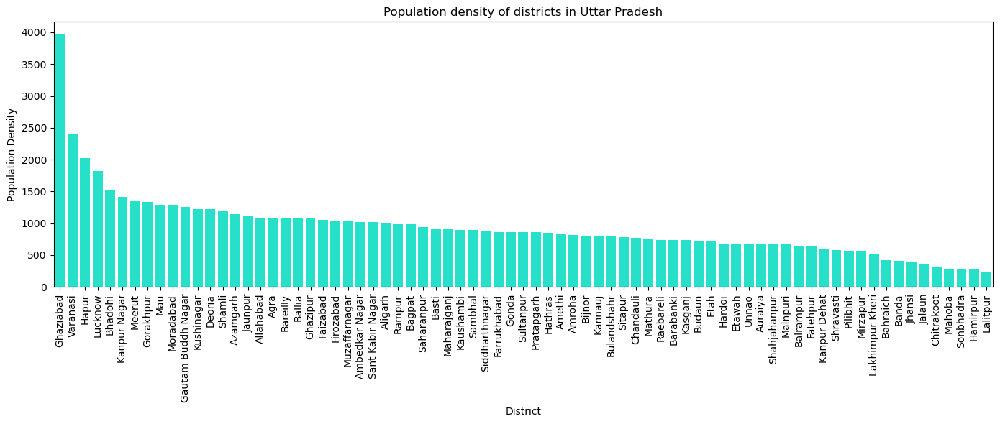
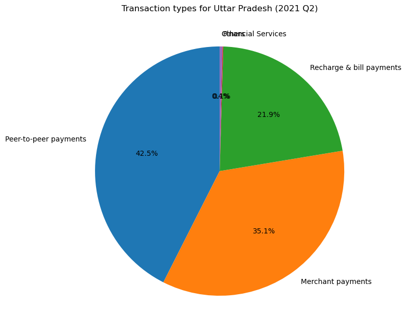

# PhonePe Digital Payments — Data Analysis

An exploratory data analysis (EDA) of PhonePe's digital payments data — transactions, users, mobile-device brands and district demographics — across Indian states and districts, covering **2018 Q1 to 2021 Q2**.

The project loads the data, checks its quality, explores transaction trends and user behaviour, and studies how demographic factors relate to digital-payment activity. All the work is in a single, well-commented Jupyter notebook.

---

## Table of contents

- [About the data](#about-the-data)
- [Data dictionary](#data-dictionary)
- [Project structure](#project-structure)
- [Tools and libraries used](#tools-and-libraries-used)
- [How to run this project](#how-to-run-this-project)
- [Key findings](#key-findings)
- [Recommendations](#recommendations)
- [Author](#author)

---

## About the data

The case study uses one Excel workbook with five sheets:

| Sheet | What it contains |
|---|---|
| `State_Txn and Users` | Transactions, amount, ATV, registered users and app opens, per state |
| `State_TxnSplit` | Transactions broken down by transaction type |
| `State_DeviceData` | Registered users per mobile brand |
| `District_Txn and Users` | Transaction information and user data at district level |
| `District Demographics` | Population, area, density, headquarters and code per district |

**Coverage:** 36 states and approximately 730 districts, from 2018 Q1 to 2021 Q2.

> **Important note on the data:** `Transactions`, `Amount (INR)` and `App Opens` are per-quarter values, but `Registered Users` is a **cumulative running total**. Registered users should not be summed across quarters. The latest quarter (2021 Q2) is used as the snapshot wherever a user count is needed.

---

## Data dictionary

- **State_Txn and Users:** State, Year, Quarter, Transactions, Amount (INR), ATV (INR), Registered Users, App Opens
- **State_TxnSplit:** State, Year, Quarter, Transaction Type, Transactions, Amount (INR), ATV (INR)
- **State_DeviceData:** State, Year, Quarter, Brand, Registered Users, Percentage
- **District_Txn and Users:** State, Year, Quarter, District, Code, Transactions, Amount (INR), ATV (INR), Registered Users, App Opens
- **District Demographics:** State, District, Headquarters, Population, Area (sq km), Density, Code, Alternate Name

---

## Project structure

```text
phonepe-digital-payments-analysis/
│
├── Data/
│   └── phonepe-digital-payments-dataset.xlsx   # Source data (5 sheets)
│
├── images/                                     # Charts exported from the analysis
│   ├── 01_national_trend.png
│   ├── 02_top_district_population.png
│   ├── 03_transaction_types_by_state.png
│   ├── 04_users_to_population.png
│   ├── 05_leading_brand.png
│   ├── 06_density_vs_transactions.png
│   ├── 07_karnataka_trend.png
│   ├── 08_app_opens_trend.png
│   ├── 09_up_district_density.png
│   └── 10_up_transaction_types.png
│
├── phonepe_digital_payments_analysis.ipynb     # Main notebook
├── unique_district_mapping.csv                 # District name-to-code mapping
├── README.md
├── requirements.txt
└── .gitignore
```

---

## Tools and libraries used

- **Python 3**
- **pandas** — loading and manipulating the data
- **numpy** — numerical operations
- **matplotlib** — data visualisation and plotting
- **seaborn** — statistical visualisations
- **openpyxl** — reading Excel workbooks through pandas

---

## How to run this project

### 1. Install the required libraries

```bash
pip install -r requirements.txt
```

### 2. Check the data file

Make sure the Excel workbook is present at:

```text
Data/phonepe-digital-payments-dataset.xlsx
```

If your workbook is stored elsewhere, update the file path inside the notebook.

### 3. Open the notebook

Run the following command from the project directory:

```bash
jupyter notebook phonepe_digital_payments_analysis.ipynb
```

Run all cells from top to bottom to reproduce the analysis and visualisations.

---

## Key findings

### 1. Digital payments grew rapidly

All-India transaction volume rose from about **134 million in 2018 Q1** to about **3.94 billion in 2021 Q2** — roughly **2,830% growth**. Transaction value also increased substantially over the same period.



### 2. A few large states dominate transaction volume

**Karnataka** leads with about **2.98 billion transactions**, and the top five states account for approximately **55%** of total transactions. Smaller states and union territories, such as Lakshadweep, contribute much lower volumes.

### 3. Peer-to-peer payments account for the largest share

Peer-to-peer payments account for approximately **45% of transactions** in the overall analysis and have the highest average transaction value (ATV), at around **₹3,338**. Merchant payments contribute approximately 34%, followed by recharge and bill payments at around 21%.



### 4. Registered-users-to-population ratios vary by state

**Delhi** has the highest registered-users-to-population ratio in the analysis, at approximately **67%**. The north-eastern states have some of the lowest ratios.

This ratio provides an indication of registered-user presence relative to population; it should not be interpreted as a direct measure of active users or unique people making payments.



### 5. Xiaomi leads mobile-brand usage in most states

**Xiaomi is the leading device brand in 28 of 36 states**, with Vivo among the other prominent brands.



### 6. Population density is associated with transaction activity

At district level, population density and transaction volume have a correlation of approximately **0.42**, while population and transaction volume have a correlation of approximately **0.49**.

These results suggest a positive association between demographic characteristics and digital-payment activity in the matched district data. However, correlation alone does not establish causation, and the results depend on the districts successfully matched across datasets.



### 7. District populations vary considerably across states

The most populous district differs from state to state. West Bengal's most populous district leads the comparison, while the most populous district in Lakshadweep has a much smaller population.



---

## Recommendations

- **Focus infrastructure and offers on high-volume states** such as Karnataka and Maharashtra, where transaction activity is substantial.
- **Run awareness and promotional campaigns in lower-volume states** to explore opportunities for greater digital-payment adoption.
- **Prioritise peer-to-peer payments**, given their large transaction share and high average transaction value.
- **Explore opportunities in states with lower registered-users-to-population ratios** to understand barriers to registration and digital-payment adoption.
- **Prioritise app compatibility and performance testing on widely used mobile brands**, particularly Xiaomi and Vivo, based on their representation in the device dataset.
- **Use district population density as one of several indicators** when evaluating where to introduce features or expand services, rather than treating density as the sole predictor of transaction activity.

---

## Additional visualisations

### Transactions and amount over time — Karnataka



### App opens over time



*Note: Interpret the initial quarters carefully if app-open data was not tracked during those periods.*

### Population density of districts in Uttar Pradesh



### Transaction types in Uttar Pradesh — 2021 Q2



---

## Author

**Satyam Vishwakarma**

Email: skv.satyam002@gmail.com

*This project was built as a data-analysis case study to practise pandas, data cleaning, exploratory analysis and data visualisation.*
